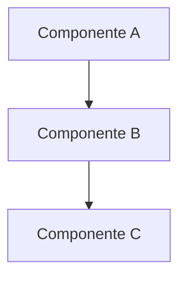

# Templates de documentación — Proyecto de ejemplo

Copiar el template correspondiente y rellenar. Eliminar las instrucciones entre `<!-- -->`.

## Table of Contents

1. [Template: Tutorial](#template-tutorial)
2. [Template: How-to Guide](#template-how-to-guide)
3. [Template: Referencia](#template-referencia)
4. [Template: Explicación](#template-explicación)
5. [Template: ADR (MADR 4.0)](#template-adr-madr-40)
6. [Template: Runbook](#template-runbook)
7. [Template: CHANGELOG entry](#template-changelog-entry)

---

## Template: Tutorial

Archivo: `docs/tutorials/nombre-del-tutorial.md`

```markdown
---
title: "Tutorial: [Qué va a lograr el lector]"
created: YYYY-MM-DD
updated: YYYY-MM-DD
author: github-username
status: draft
prerequisites:
  - Acceso a [sistema/herramienta]
  - Conocimiento básico de [tema]
estimated_time: "XX minutos"
---

# Tutorial: [Qué va a lograr el lector]

<!-- Máximo 2 líneas describiendo qué construirán/lograrán -->

Al final de este tutorial tendrás [resultado concreto].

## Antes de empezar

<!-- Lista de requisitos previos: software instalado, accesos, cuentas -->

- [ ] Node.js 20+ instalado
- [ ] Acceso al repo `ejemplo/[proyecto]`
- [ ] API key de [servicio]

## Paso 1: [Verbo en infinitivo — Configurar el entorno]

<!-- Instrucciones concretas. Cada paso produce un resultado verificable -->

```bash
comando-ejemplo
```

Deberías ver:

```
output esperado
```

## Paso 2: [Siguiente acción]

<!-- Continuar con pasos numerados secuenciales -->

## Paso 3: [Siguiente acción]

## Verificar que todo funciona

<!-- Prueba final que confirma que el tutorial se completó exitosamente -->

## Siguiente paso

<!-- Apuntar a un how-to o doc de referencia relacionado -->

- Para personalizar [X], ver [guía de configuración](../guides/configurar-x.md)
- Para entender cómo funciona internamente, ver [explicación de arquitectura](../explanation/arquitectura-x.md)
```

---

## Template: How-to Guide

Archivo: `docs/guides/verbo-tarea-especifica.md`

```markdown
---
title: "Cómo [tarea específica]"
created: YYYY-MM-DD
updated: YYYY-MM-DD
author: github-username
status: draft
---

# Cómo [tarea específica]

<!-- 1-2 líneas: cuándo usar esta guía y qué resuelve -->

## Prerrequisitos

<!-- Solo lo que se necesita para ESTA tarea. Asumir conocimiento básico del sistema -->

## Procedimiento

### 1. [Primer paso]

<!-- Instrucciones directas. Sin explicar "por qué" (eso va en explanation/) -->

### 2. [Siguiente paso]

### 3. [Siguiente paso]

## Verificación

<!-- Cómo confirmar que la tarea se completó correctamente -->

## Solución de problemas

<!-- Errores comunes y cómo resolverlos -->

| Error | Causa | Solución |
|---|---|---|
| `ERROR_CODE` | Descripción breve | Paso a seguir |

## Ver también

- [Doc relacionado](../ruta/al-doc.md)
```

---

## Template: Referencia

Archivo: `docs/reference/nombre-componente.md`

```markdown
---
title: "Referencia: [Componente/Módulo/API]"
created: YYYY-MM-DD
updated: YYYY-MM-DD
author: github-username
status: draft
---

# [Componente/Módulo/API]

<!-- Descripción factual de una línea: qué es y qué hace -->

## Configuración

| Parámetro | Tipo | Default | Descripción |
|---|---|---|---|
| `param_name` | `string` | `""` | Qué hace este parámetro |

## Métodos / Endpoints / Funciones

### `nombreMetodo(param1, param2)`

<!-- Firma, parámetros, retorno, excepciones. Sin tutoriales ni contexto -->

**Parámetros:**

| Nombre | Tipo | Requerido | Descripción |
|---|---|---|---|
| `param1` | `string` | Sí | Descripción |

**Retorna:** `TipoRetorno` — Descripción

**Ejemplo:**

```typescript
const result = nombreMetodo("valor", 42);
```

## Variables de entorno

| Variable | Requerida | Descripción |
|---|---|---|
| `TALENT_API_KEY` | Sí | API key del servicio |

## Límites y restricciones

<!-- Rate limits, tamaños máximos, timeouts, etc. -->
```

---

## Template: Explicación

Archivo: `docs/explanation/tema-conceptual.md`

```markdown
---
title: "[Tema conceptual]"
created: YYYY-MM-DD
updated: YYYY-MM-DD
author: github-username
status: draft
---

# [Tema conceptual]

<!-- Tono conversacional. Aquí se explica el "por qué", no el "cómo" -->

## Contexto

<!-- ¿Qué problema existía? ¿Qué motivó esta decisión/diseño? -->

## Cómo funciona

<!-- Explicación conceptual. Diagramas Mermaid son bienvenidos aquí -->



## Trade-offs y alternativas

<!-- ¿Qué se ganó y qué se sacrificó? ¿Qué otras opciones se evaluaron? -->

## Lecturas relacionadas

- [ADR-NNNN: Decisión relacionada](../decisions/NNNN-titulo.md)
- [Referencia técnica](../reference/componente.md)
```

---

## Template: ADR (MADR 4.0)

Archivo: `docs/decisions/NNNN-descripcion-corta.md`

```markdown
---
title: "ADR-NNNN: [Título de la decisión]"
created: YYYY-MM-DD
updated: YYYY-MM-DD
author: github-username
status: proposed | accepted | deprecated | superseded
deciders: [equipo-o-personas]
supersedes: NNNN  # Solo si reemplaza un ADR anterior
---

# ADR-NNNN: [Título de la decisión]

## Estado

[Proposed | Accepted | Deprecated | Superseded by [ADR-XXXX](XXXX-titulo.md)]

## Contexto

<!-- ¿Qué situación obliga a tomar esta decisión? Hechos, no opiniones -->

## Drivers de decisión

<!-- Factores que influyen en la elección -->

- Requisito de rendimiento para X usuarios concurrentes
- Experiencia del equipo con [tecnología]
- Presupuesto de infraestructura
- Timeline de entrega

## Opciones consideradas

### Opción 1: [Nombre]

<!-- Descripción breve -->

- ✅ Ventaja 1
- ✅ Ventaja 2
- ❌ Desventaja 1

### Opción 2: [Nombre]

- ✅ Ventaja 1
- ❌ Desventaja 1
- ❌ Desventaja 2

### Opción 3: [Nombre]

- ✅ Ventaja 1
- ✅ Ventaja 2
- ❌ Desventaja 1

## Decisión

Opción elegida: **[Nombre]**, porque [razón principal en una oración].

<!-- Expandir el razonamiento si es necesario -->

## Consecuencias

### Positivas

- Consecuencia positiva 1
- Consecuencia positiva 2

### Negativas

- Consecuencia negativa 1 → Mitigación: [cómo se mitiga]

### Neutrales

- El equipo necesitará capacitación en [tecnología]
```

---

## Template: Runbook

Archivo: `docs/runbooks/nombre-procedimiento.md`

```markdown
---
title: "Runbook: [Nombre del procedimiento]"
created: YYYY-MM-DD
updated: YYYY-MM-DD
author: github-username
status: draft
severity: low | medium | high | critical
---

# Runbook: [Nombre del procedimiento]

## Resumen

| Campo | Valor |
|---|---|
| **Cuándo ejecutar** | [Trigger: alerta, solicitud, schedule] |
| **Quién ejecuta** | [Rol: SRE, Backend lead, cualquier dev] |
| **Tiempo estimado** | XX minutos |
| **Impacto si no se ejecuta** | [Qué pasa si se ignora] |

## Prerrequisitos

- Acceso a [sistema/servidor/consola]
- Permisos de [nivel]

## Procedimiento

### 1. [Primer paso]

```bash
comando-a-ejecutar
```

**Resultado esperado:** [Qué deberías ver]

### 2. [Siguiente paso]

### 3. Verificar

<!-- Cómo confirmar que el procedimiento fue exitoso -->

## Si algo sale mal

| Síntoma | Acción |
|---|---|
| [Error/comportamiento] | [Paso correctivo] |

## Rollback

<!-- Cómo revertir si el procedimiento causó problemas -->

## Historial de ejecución

| Fecha | Ejecutado por | Notas |
|---|---|---|
| YYYY-MM-DD | @github-user | Ejecución limpia |
```

---

## Template: CHANGELOG entry

Seguir formato [Conventional Commits](https://conventionalcommits.org) + [Keep a Changelog](https://keepachangelog.com):

```markdown
## [X.Y.Z] - YYYY-MM-DD

### Added
- Nuevo endpoint `/api/v2/events/search` para búsqueda full-text (#123)

### Changed
- Migración de PostgreSQL 15 → 16 para mejorar rendimiento JSON (#145)

### Fixed
- Corrección de timeout en webhook de pagos cuando payload > 1MB (#156)

### Deprecated
- Endpoint `/api/v1/events` será removido en v3.0

### Removed
- Soporte para Node.js 18 (EOL)

### Security
- Actualización de dependencia `jsonwebtoken` por CVE-2025-XXXXX
```
